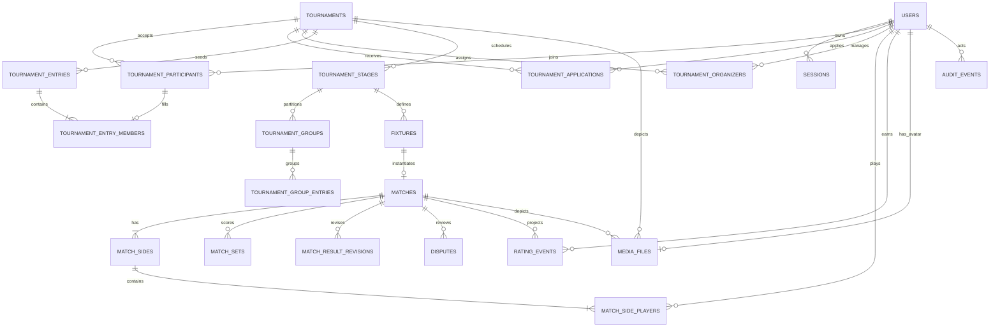
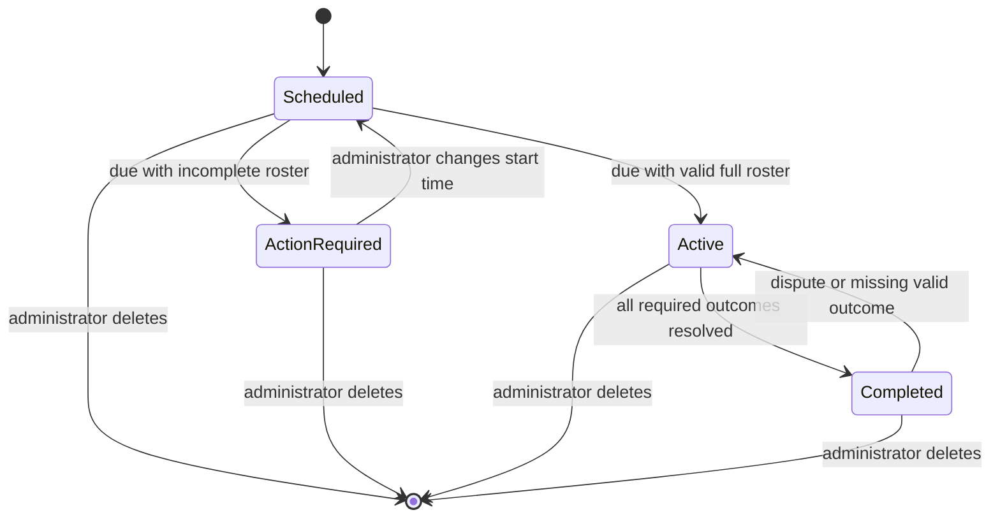
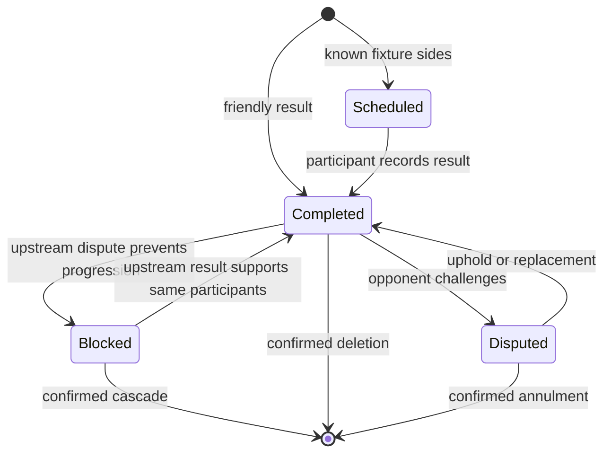

# Architecture and data model

FastAPI validates request contracts. Services check actor membership, permissions, and state transitions before changing normalized SQLAlchemy records. Alembic owns schema DDL. Vite produces a static React SPA. Node runs the reference frontend server and supplies runtime API origin configuration. The API runs its own scheduler in the backend process.

A registered user supplies the player identity everywhere. Accepted roster positions and seed positions are distinct. Fixed teams contain exactly two roster members at startup. Fixture edges reference upstream fixture IDs, and schedule labels are separate from actual playing times. The rotation uses independent structural slots so deletion of a played match can reconstruct the scheduled fixture without restoring the deleted facts.

All writes share a PostgreSQL transaction advisory lock. The due-date reconciler selects candidates and rereads each candidate under both the advisory lock and a row lock. Writes, fixture changes, media metadata, and full Elo replay commit together. Public reads use PostgreSQL repeatable-read snapshots. Operations use match versions and client-generated idempotency keys to protect retries. Multiple backend processes must share the same database, rating configuration, and persistent media.

The filesystem adapter writes sanitized images and thumbnail siblings outside PostgreSQL. Delete transactions enqueue idempotent file removal. Startup and periodic maintenance retry removals and sweep old unreferenced objects. A future S3-compatible implementation can replace the storage interface and provide its own streaming/deletion semantics.
